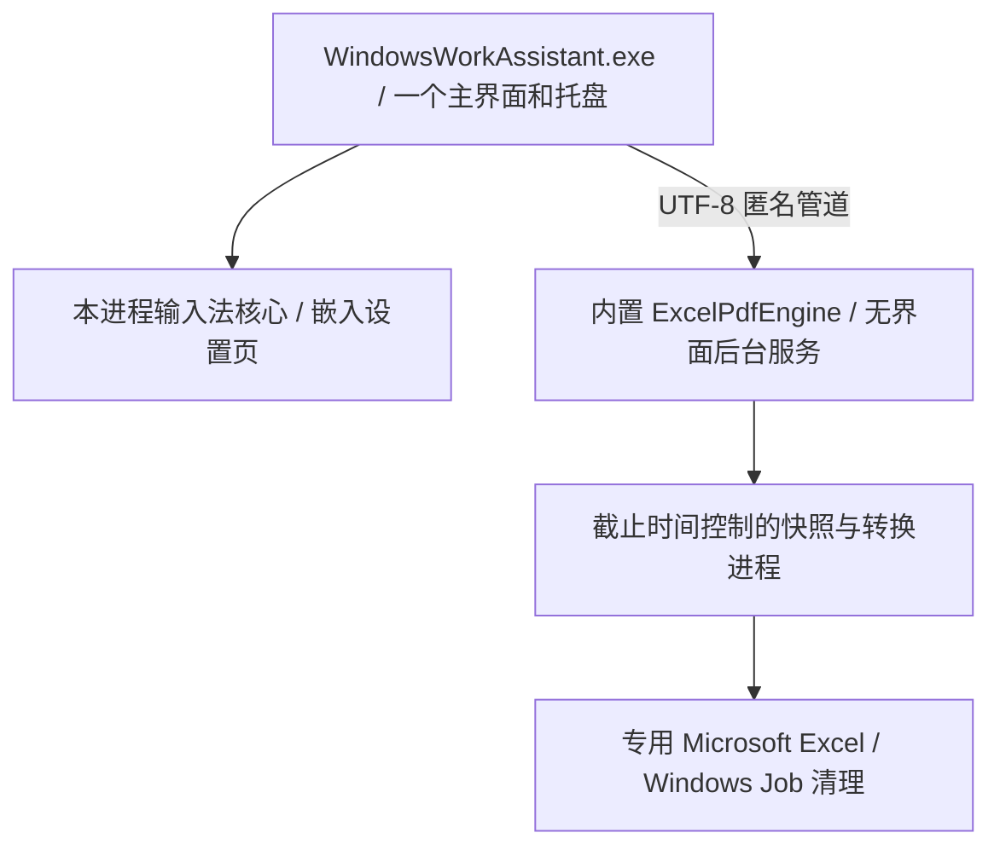

# Windows 效率助手 / Windows Work Assistant

One Windows app for foreground-aware IME switching and automatic Excel-to-PDF export.

**一个主界面、一个托盘、一个开机启动项**，可独立开启输入法模块或 Excel 转 PDF。当前版本 **1.0.1**。

| 需要的功能 | 选择 |
|---|---|
| 只需要自动切英文 | [auto-ime-switcher](https://github.com/zhang18166/auto-ime-switcher) |
| 只需要 Excel 转 PDF | [excel-auto-pdf](https://github.com/zhang18166/excel-auto-pdf) |
| 两者一起用 | [下载整合版](https://github.com/zhang18166/windows-work-assistant/releases) |

## 安装与使用

Windows 10/11 x64，.NET Framework 4.8；PDF 模块另需安装 Microsoft Excel 桌面版。
下载 Release ZIP，解压运行 `WindowsWorkAssistant.exe`。无需安装 Python 或手动启动两个独立软件。

- 顶部可分别开关两个模块；输入法页保留规则、切换方式、背景透明浮窗、重置位置及诊断信息。
- Excel 页显示监控目录、状态、任务数、预计时间及带时间的日志；“监控设置”配置目录、子文件夹与超时。
- 关闭主窗口收进唯一的托盘；托盘菜单或输入法设置页里的“退出”退出整个整合程序。
- 开机启动使用当前用户 Run 项 `WindowsWorkAssistant` 和 `--silent`。静默启动隐藏主界面，按保存的模块开关工作。
- 使用整合版前退出两份独立版。程序主动检查互斥，避免同一输入状态或工作簿被重复处理。

已有配置直接沿用：输入法 `%APPDATA%\AutoImeSwitcher`，PDF `%APPDATA%\Excel自动转PDF`。
整合模块开关在 `%APPDATA%\WindowsWorkAssistant\settings.json`；整合运行日志为同目录 `suite.log`。
原独立版文件和配置不删除；要切回独立版，退出整合版并取消其启动项，再运行需要的独立软件。

**不会改变 Windows 剪贴板历史、跨设备同步或微信输入法剪贴板设置。** 本软件不修复第三方剪贴板占用冲突。
Excel 成功导出后覆盖同名 PDF；启动不主动扫描已有工作簿。具体功能与限制见对应组件 README。

## 实现方式



输入法代码直接编译进同一个 EXE。PDF 引擎作为校验 SHA-256 的嵌入资源，首次运行释放到
`%LOCALAPPDATA%\WindowsWorkAssistant\runtime\版本-哈希`。任务管理器会出现必要的后台服务和 Excel 工作进程，
但不再运行两套独立界面、托盘或启动项。引擎不开放网络端口；宿主异常退出时用 Job 结束其自建进程树。

`components/` 是两个独立仓库的可复现源码快照，具体提交和来源见 `components.lock.json`。
不是运行时从互联网下载代码；不需要 Git submodule，也不包含用户配置、实际工作簿或日志。

## 构建

安装 Windows .NET Framework 4.8 和 Python 3.12 x64：

```powershell
python -m venv .venv
.venv\Scripts\python.exe -m pip install -r components/excel-auto-pdf/requirements.txt
.venv\Scripts\python.exe tools/verify_components.py
powershell -ExecutionPolicy Bypass -File tools/build.ps1 -Python .venv\Scripts\python.exe
powershell -ExecutionPolicy Bypass -File tools/test.ps1
```

输出：`dist/v1.0.1/WindowsWorkAssistant.exe`，已经包含 PDF 引擎。
`tools/test.ps1` 隔离配置目录，检查模块开关、配置恢复、内嵌设置、小窗口日志、中文管道和退出清理；不模拟真实按键。
完整验证还应分别运行组件回归及需要本机 Excel 的 `tests/service_integration.py --engine <引擎路径>`。

源码：`src/` 为整合窗口、资源校验、进程所有权与状态调度，`components/` 为独立组件，`tools/` 为构建和检查。
详细生命周期见 [开发说明](docs/ARCHITECTURE.md)。

采用 [MIT License](LICENSE)。第三方运行时许可证随发布包提供。
